<h3>Studying at the intersection of math, problem solving and Python coding</h3>

  
  
  

  
  
  
  

---

## 👋 About me

I write Python to solve problems and use math to test whether the solution works. I've been coding since 3rd grade (LEGO EV3 block coding first, then Python) and I'm halfway through Harvard's CS50 Python.

I've led the coding on two face-recognizing robots with my school teams, built a sensor rig that tells tight railway bolts from loose ones, and run a 1.1k-member online community with a staff of about 30.

**How I work:** I start from a real problem, build the smallest version that runs, test it on real data, and write down what didn't work. Rail-Guard and Quorum both have a problem log in their docs.

---

## 🏆 Achievements

- **Head Coder and Team Lead, AURA** (my school's first student-built humanoid robot). Built the entire GUI and every feature in it, taught my teammates Python and delegated their parts. Finished the coding ahead of the annual day deadline and helped the other teams finish theirs. Launched in front of 3,000+ parents and students at Blitzing 2025.
- **Featured in the Times of India Education Guide**, 17 Dec 2025, for AURA.
- **WRO Future Innovators:** team lead and coder for Soul Sync. Silver in the online round, bronze at regionals.
- **World Robot Olympiad event team:** invited after competing. Helped evaluate 42 teams, shadow-judged 12 projects, sat in on the meeting that chose the 6 teams going to nationals, and gave the closing speech.
- **2nd place, Codeferno** (interschool coding competition), as a 10th grader against 11th and 12th graders.
- **Founder of Quorum** (a Discord scheduling bot, built in 10th grade) **and of Origin:** a 1.1k-member community with a staff of about 30 and a full event calendar. I handle hosting, hiring and managing staff, and the events.

---

## 📌 Projects

| Project | What it is | Built with |
|---|---|---|
| [**AURA**](https://github.com/MohitSheth10/Humanoid-Bot) | My school's first student-built humanoid. I led the coding team and built its face recognition and interface. It played dandiya on stage for 3,000+ people and now goes around school as an interactive robot. | Python, OpenCV, LBPH with KNN fallback, PyQt5, AssemblyAI, pyttsx3 |
| [**Soul Sync**](https://github.com/MohitSheth10/Soul-Sync) | In 9th grade I wrote 800+ lines of Python for a robot that works as an emotion counselor. It recognizes you with a face-recognition model I built, reads your mood from your face, and changes the lighting around you to match. Built for WRO Future Innovators: silver online, bronze at regionals. | Python, OpenCV, Keras, Cohere, SQLite, Tkinter, SpeechRecognition, pyttsx3 |
| [**Rail-Guard**](https://github.com/MohitSheth10/Rail-Guard) | I built the electronics and mounted the sensor on a model rail track to detect loose fishplate bolts from vibration data alone. The software compares the vibration energy in two frequency bands (found with an FFT), and that ratio told tight and loose joints apart on every test recording (bench-scale, one joint). | Python, ESP32, accelerometer, FFT |
| **Quorum** (code not yet released) | Noticing that plans, meetings and study groups kept stalling on finding a common time, I wrote a Discord bot that finds shared free times, including across timezones. Built in 10th grade. Since it had real use, I set up a storefront and made marketing videos for it with a friend. Now working on a way to host it 24/7. | Python, discord.py |
| [Games](https://github.com/MohitSheth10/Games) · [Hangman](https://github.com/MohitSheth10/Hangman) · [Accounts](https://github.com/MohitSheth10/Accounts) · [Turtle](https://github.com/MohitSheth10/Turtle) | Smaller projects from learning Python: a GUI Tic Tac Toe and other games, Hangman, a PIN-protected ATM simulator with file storage, and turtle graphics. | Python |

---

## ⚙️ Tech

  

| Area | Tools |
|---|---|
| Programming | Python, SQL |
| Computer vision | OpenCV (face detection and recognition) |
| Interface design | PyQt5, Tkinter (desktop applications) |
| Machine learning | Keras (emotion detection), LBPH and KNN (face recognition) |
| AI and speech | Cohere (conversational AI), SpeechRecognition, pyttsx3, AssemblyAI |
| Databases | SQLite |
| Signal processing | FFT, band-energy ratios (Rail-Guard) |
| Data and maths | NumPy, Pandas |
| Hardware | Arduino, Raspberry Pi, ESP32, accelerometer sensors |
| Bots | discord.py (Quorum) |
| Web | HTML, CSS |

---

## 🎯 Right now

- Working through Harvard's CS50 Python
- Studying the IB Diploma Programme
- Learning web development (HTML, CSS)

---

  

